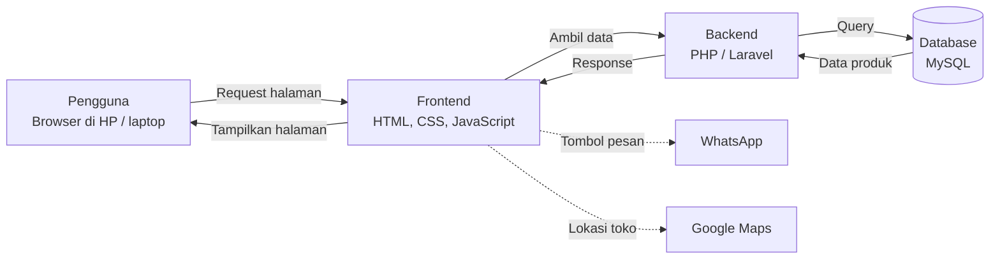
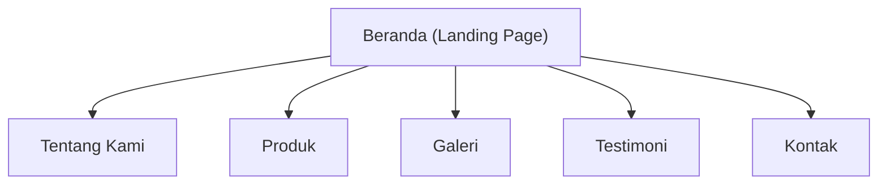
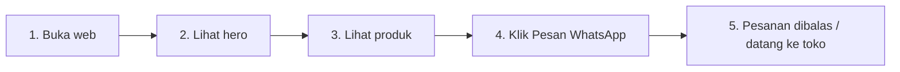

# Kedai Kopi Minahasa: Konsep Website UMKM

Tugas Praktikum Pemrograman Web, Semester 3 Teknologi Informasi.

Website sederhana untuk UMKM **Kedai Kopi Minahasa** (contoh kasus). Tujuannya memperkenalkan produk, menarik pelanggan baru, dan memudahkan pemesanan lewat WhatsApp.

## Isi repository

```
kopi-minahasa/
├── index.html                    # Landing page
├── style.css                     # Tampilan (CSS)
├── README.md                     # Dokumen ini
└── docs/
    └── Konsep_Website_UMKM.pptx  # Slide presentasi konsep
```

---

## 1. Arsitektur Web



| Lapisan | Teknologi | Tugas |
|---|---|---|
| Pengguna | Browser | Membuka website |
| Frontend | HTML, CSS, JavaScript | Menampilkan landing page |
| Backend | PHP / Laravel | Memproses data produk dan pesan |
| Database | MySQL | Menyimpan produk, pesanan, kontak |
| Layanan luar | WhatsApp, Google Maps | Pemesanan dan lokasi |

> Versi saat ini baru bagian **frontend** (landing page statis). Backend dan database adalah rencana pengembangan berikutnya.

### Struktur halaman



---

## 2. Landing Page

File: [`index.html`](index.html) dan [`style.css`](style.css).

Sketsa tata letak:

```
+--------------------------------------------------+
| Kopi Minahasa      Tentang Produk Galeri Kontak  |  <- 1. Navbar
+--------------------------------------------------+
| Kopi asli Minahasa, diseduh        ( gambar      |
| dari biji pilihan                    cangkir )   |  <- 2. Hero
| [ Pesan via WhatsApp ]                           |
+--------------------------------------------------+
| Tentang kami                                     |  <- 3. Tentang
+--------------------------------------------------+
| [Kopi Tubruk] [Kopi Susu] [Pisang] [Klapper]     |  <- 4. Produk
+--------------------------------------------------+
| [foto] [foto] [foto] [foto]                      |  <- 5. Galeri
+--------------------------------------------------+
| "Ulasan 1"   "Ulasan 2"   "Ulasan 3"             |  <- 6. Testimoni
+--------------------------------------------------+
| Alamat, jam buka, WhatsApp        [ Peta ]       |  <- 7. Kontak
+--------------------------------------------------+
```

<!-- Tambahkan screenshot hasil website di sini:

-->

### Cara menjalankan

1. Download atau clone repository ini.
2. Buka `index.html` di browser, atau gunakan ekstensi **Live Server** di VS Code.

---

## 3. User Story

### Alur pengguna saat membuka website



1. **Buka web:** pengunjung membuka alamat website lewat HP.
2. **Lihat hero:** langsung tahu usaha dan produknya.
3. **Lihat produk:** menggulir daftar produk dan harga.
4. **Klik pesan:** menekan tombol WhatsApp untuk memesan.
5. **Selesai:** pesanan dibalas atau pengunjung datang ke toko.

### Daftar user story

| Sebagai | Saya ingin | Agar |
|---|---|---|
| Pengunjung baru | melihat profil dan produk di halaman utama | tahu apa yang dijual dan percaya pada usahanya |
| Pembeli | melihat daftar produk, foto, dan harga | bisa memilih dan membandingkan produk |
| Pembeli | menekan tombol Pesan via WhatsApp | bisa memesan tanpa daftar akun |
| Pengunjung | melihat alamat, jam buka, dan peta | bisa datang langsung ke toko |
| Pemilik UMKM | mengelola produk lewat halaman admin | harga dan stok selalu terbaru |

---

## Pembuat

Nama: *(isi nama kamu)*
NIM: *(isi NIM kamu)*
Dosen: *(isi nama dosen)*
